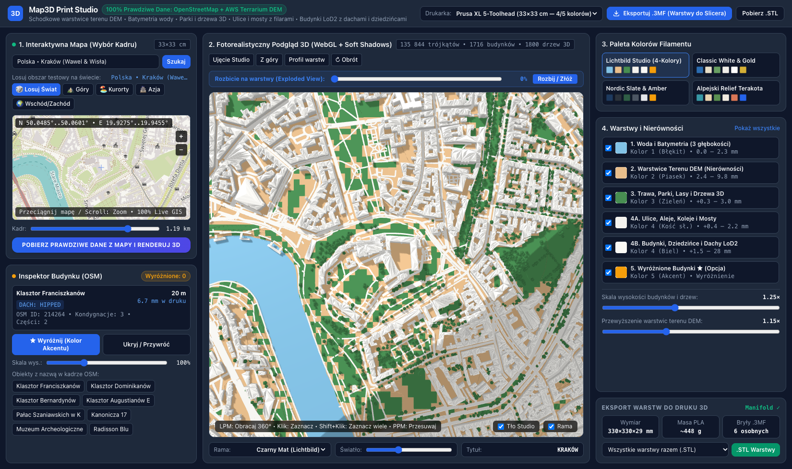
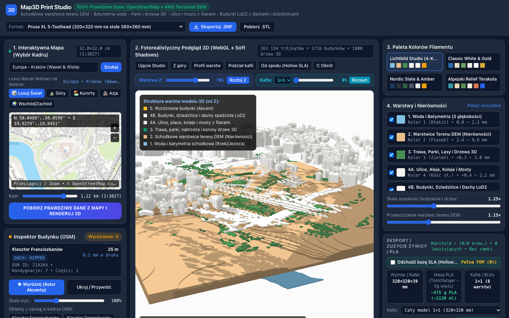
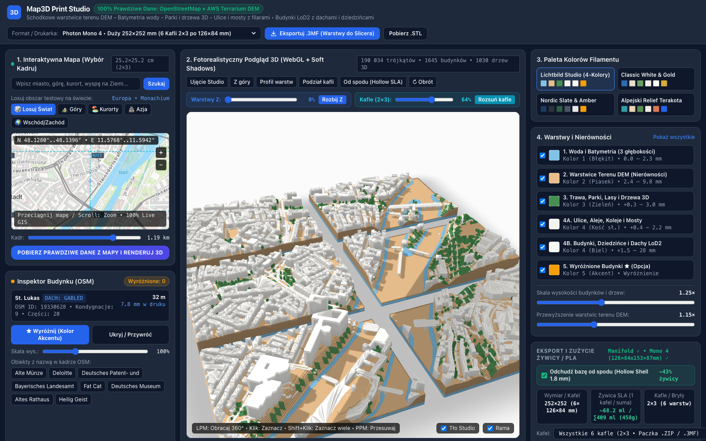
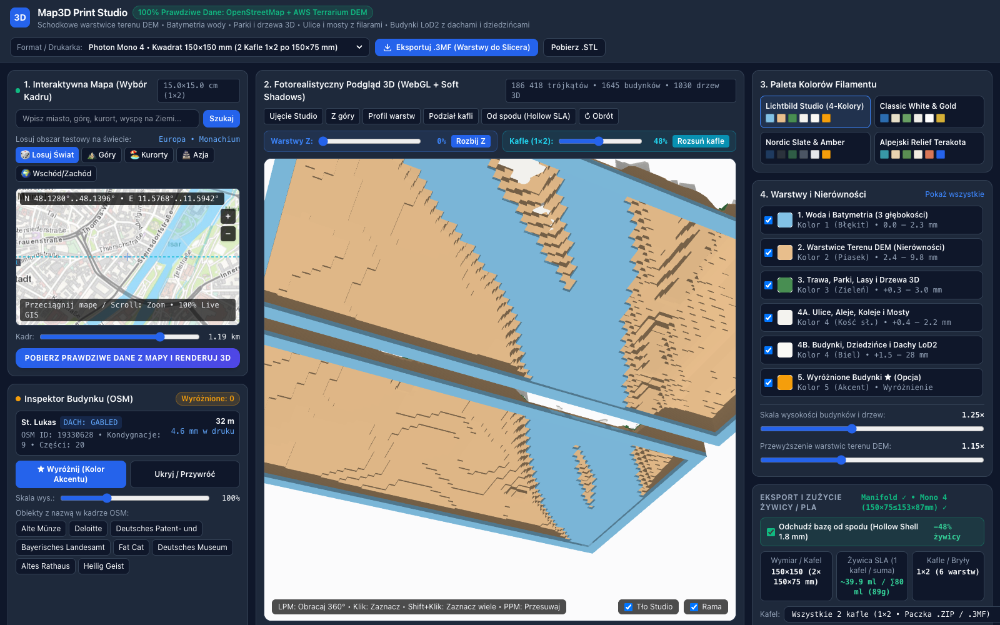
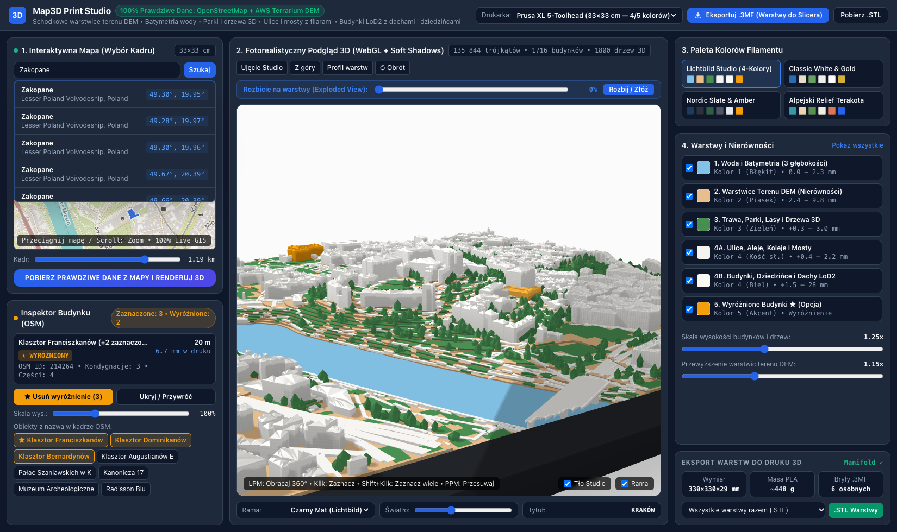
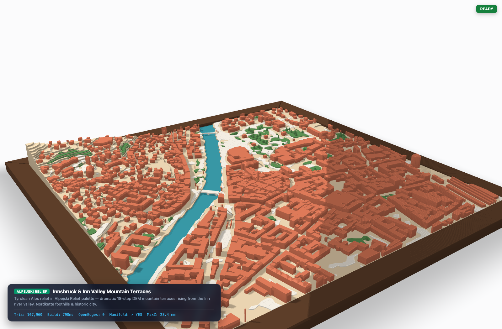
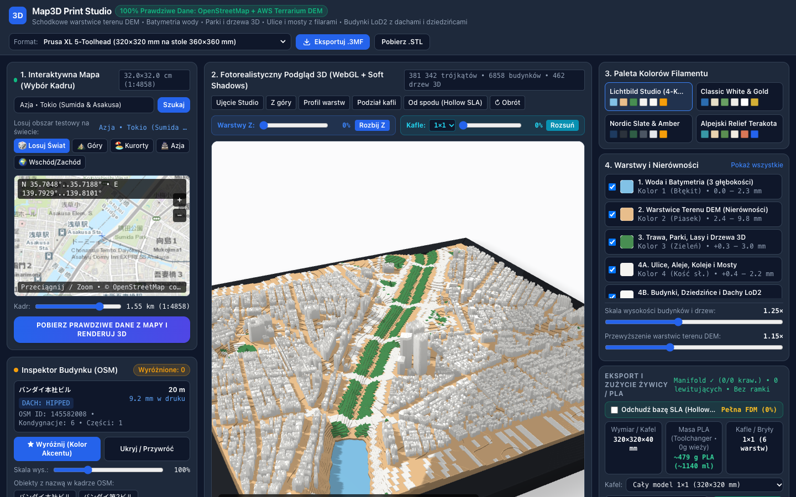
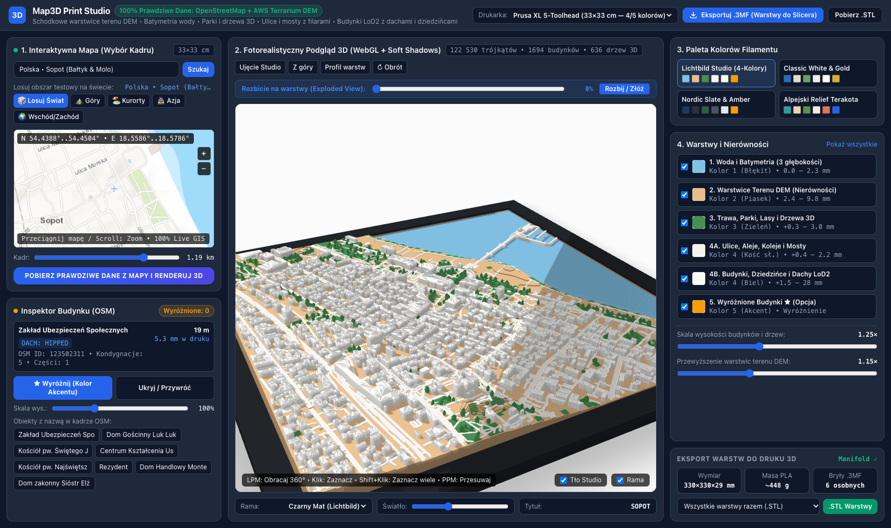

# map-to-3dprint

`map-to-3dprint` generates multi-color, watertight 3D-printable terrain and city models (`.3mf`, `.stl`, and multi-tile `.zip`) from live geographic data.

The system downloads elevation tiles from AWS Terrarium DEM and vector geometry from OpenStreetMap (Overpass API). It builds six closed manifold volumes for:
- **Resin SLA / MSLA 3D Printers** (specifically tailored for the **Anycubic Photon Mono 4** with a `153.4 × 87 × 165 mm` build volume and `2.2 L` maximum capacity, including automatic multi-tile splitting and an open `1.8 mm` hollow underside shell).
- **Multi-Extruder FDM 3D Printers** (such as Prusa XL, Bambu Lab AMS, and Voron ERCF, with a `5 mm` safety bed margin).



---

## 1. System Description

The application operates in two modes:

1. **Local GIS Server + WebGL Studio (`server.py`)**: A Python HTTP server fetches, processes, and caches DEM and OpenStreetMap data on disk.
2. **Standalone Browser Mode (`index.html`)**: The browser fetches AWS Terrarium DEM tiles and Overpass QL data directly if the local Python server is offline.

### Data Sources

| Data Layer | Source | Format | Usage |
| :--- | :--- | :--- | :--- |
| Elevation (DEM) | AWS Terrain Tiles (`terrarium`) | 24-bit PNG (`z = 14`) | Stepped terrain contour layers and sea-level bathymetry |
| Vector Geometry | OpenStreetMap (Overpass API) | JSON | Buildings (`building`, `building:part`), coastlines (`natural=coastline`), piers (`man_made=pier`), water, parks, trees, roads, bridges |
| Geocoding | Photon Komoot (`photon.komoot.io`) | GeoJSON | Live place search and coordinate lookup |
| 2D Slippy Map | OpenStreetMap France (`hot`) / ArcGIS | Raster PNG | Interactive 2D bounding-box and tile-grid selection |

---

## 2. 3D Print Layer Architecture

The mesh builder clips all geometry to the internal model boundary (`[-84.6, 84.6]` scene units), splits geometry across the selected tile grid (`cols × rows`), and closes every volume with bottom caps and perimeter walls.

> [!IMPORTANT]
> The decorative studio frame (`meshes.frame`, Layer `6`) is used only in the 3D WebGL preview. The `.3mf` and `.stl` exporters exclude `meshes.frame` so that only the six printable map layers (`0` through `5`) are exported to the slicer.

| Layer ID | Layer Name | Default Extruder | Closed Manifold Structure |
| :--- | :--- | :--- | :--- |
| `0` | Water and Stepped Bathymetry | Extruder 1 (Blue) | Closed water plate (`0.0 - 2.3 mm`) + 3 stepped depth contours + open underside vault |
| `1` | DEM Terrain Contours | Extruder 2 (Sand) | 18 quantized elevation terraces from DEM (`2.4 - 9.8 mm`) + stepped underside hollow shell (`1.8 mm`) |
| `2` | Parks, Forests, and 3D Trees | Extruder 3 (Green) | Closed 3D turf slabs (`0.34 mm` thick) + closed 5-sided 3D tree crowns with bottom caps |
| `3` | Streets, Plazas, Railways, Bridges | Extruder 4 (Ivory/White) | Closed 6-sided road prisms + elevated bridge decks with watertight support piers |
| `4` | LoD2 Buildings and Courtyards | Extruder 4 (White) | Extruded walls, inner courtyards, flat bottom floor caps, and pitched roofs (`hipped`, `gabled`, `pyramidal`, `dome`) |
| `5` | Highlighted Buildings (Accent) | Extruder 5 (Gold/Accent) | User-selected buildings exported as a separate closed volume |
| `6` | Studio Frame *(Preview Only)* | *Not Exported* | Mitered display frame rendered only in the 3D viewport |



---

## 3. Anycubic Photon Mono 4 Formats and Hollow SLA Shell

The **Anycubic Photon Mono 4** provides a rectangular build volume of **`153.4 × 87 × 165 mm`** (maximum print volume **`2.2 L`**). Because the Y-axis limit is `87 mm`, a single square print cannot exceed `84 × 84 mm`. To print larger square maps (`150 × 150 mm` up to `296 × 296 mm`), `map-to-3dprint` divides the square map into rectangular tiles (`cols × rows`) where every tile fits flat inside `153.4 × 87 mm`:

| Format Preset | Assembled Map Size | Tile Grid (`cols × rows`) | Single Tile Size (`X × Y`) | Solid Volume (`ml`) | Hollow Shell `1.8 mm` (`ml` / `g` Total) | Resin per Tile (`ml` / `g`) |
| :--- | :--- | :--- | :--- | :--- | :--- | :--- |
| **Photon Mono 4 • Single (`1×1`)** | `84 × 84 mm` | `1 × 1` (1 tile) | `84.0 × 84.0 mm` | `~29.4 ml` | **`~15.8 ml` (`~18 g`, `-46%`)** | `~15.8 ml` (`~18 g`) |
| **Photon Mono 4 • Square (`1×2`)** | `150 × 150 mm` | `1 × 2` (2 tiles) | `150.0 × 75.0 mm` | `~167.7 ml` | **`~80.0 ml` (`~89 g`, `-48%`)** | `~40.0 ml` (`~45 g`) |
| **Photon Mono 4 • Mosaic (`2×2`)** | `168 × 168 mm` | `2 × 2` (4 tiles) | `84.0 × 84.0 mm` | `~235.5 ml` | **`~120.4 ml` (`~135 g`, `-49%`)** | `~30.1 ml` (`~34 g`) |
| **Photon Mono 4 • Large (`2×3`)** | `252 × 252 mm` | `2 × 3` (6 tiles) | `126.0 × 84.0 mm` | `~794.8 ml` | **`~439.0 ml` (`~492 g`, `-45%`)** | `~73.2 ml` (`~82 g`) |
| **Photon Mono 4 • XL Wall (`2×4`)** | `296 × 296 mm` | `2 × 4` (8 tiles) | `148.0 × 74.0 mm` | `~1287.9 ml` | **`~718.0 ml` (`~804 g`, `-44%`)** | `~89.8 ml` (`~101 g`) |

### Multi-Tile 3D Split (`2×3` Tiles of `126 × 84 mm` for Anycubic Photon Mono 4)



### Open Underside Hollow Shell (`1.8 mm` Wall + Solid `z = 0` Mounting Rim)

Each tile features a solid 2-cell mounting rim at `z = 0 mm` around all four edges and a recessed underside vault that follows the DEM terrain contours. The cavity is fully open from underneath, preventing trapped uncured resin during SLA printing.



---

## 4. Requirements

- **Operating System**: macOS, Linux, or Windows
- **Python**: Version 3.9 or newer (standard library only; no `pip` packages required)
- **Command-Line Tool**: `curl` (installed by default on macOS, Linux, and Windows 10/11)
- **Web Browser**: Chrome, Firefox, Safari, or Edge with WebGL 1.0 (`OES_standard_derivatives` and `WEBGL_depth_texture`)

---

## 5. Installation and Startup

Follow these steps to run the application locally:

1. Clone the repository:
   ```bash
   git clone https://github.com/pisze-programy/map-to-3dprint.git
   ```
2. Change to the project directory:
   ```bash
   cd map-to-3dprint
   ```
3. Start the local GIS server:
   ```bash
   python3 server.py
   ```
4. Open `http://127.0.0.1:8765` in your web browser.

> [!NOTE]
> You can also open `index.html` directly in a web browser without `server.py`. When `server.py` runs, it caches downloaded OSM and DEM files in the `cache/` directory for faster reloads.

---

## 6. Operating Procedure

### 6.1 Select a Geographic Area

1. Type a city, mountain, island, or address into the search box in panel **1. Interaktywna Mapa**.
2. Click a location from the live autocomplete dropdown list, or click **Szukaj**.
3. Alternatively, click one of the world randomizer buttons (`🎲 Losuj Świat`, `⛰️ Góry`, `🏖️ Kurorty`, `🏯 Azja`, `🌍 Wschód/Zachód`) to load a test region.
4. Drag the 2D map with the left mouse button to position the blue print frame. When a multi-tile format is active, dashed cyan lines on the 2D map show the exact tile boundaries (`R1C1` through `R4C2`).
5. Scroll the mouse wheel on the 2D map (or click `+` and `-`) to change the map zoom level.
6. Adjust the **Kadr** slider to set the physical ground width (`0.60 km` to `1.35 km`).
7. Click **POBIERZ PRAWDZIWE DANE Z MAPY I RENDERUJ 3D** to download the GIS data and generate the 3D mesh.

### 6.2 Inspect and Select Buildings



1. Left-click and drag in the 3D viewport to rotate the camera.
2. Right-click and drag (or middle-click and drag) in the 3D viewport to pan the camera.
3. Scroll the mouse wheel in the 3D viewport to zoom in or out.
4. Left-click any building in the 3D viewport to select that building group (`building` + all associated `building:part` elements).
5. Hold `Shift` and left-click additional buildings to select multiple buildings at the same time.
6. In the **Inspektor Budynku (OSM)** panel, click **★ Wyróżnij (Kolor Akcentu)** to move the selected buildings to the accent extruder layer (Layer 5).
7. Adjust the **Skala wys.** slider to change the height multiplier (`50%` to `250%`) of the selected buildings.
8. Click **Ukryj / Przywróć** to exclude or restore the selected buildings from the 3D print mesh.

### 6.3 Inspect Layers, Tiles, and Hollow Underside

1. Drag the **Warstwy Z** slider (or click **Rozbij Z**) to separate the six volumes along the Z-axis.
2. Drag the **Kafle (`cols×rows`)** slider (or click **Rozsuń kafle** / **Podział kafli**) to separate the individual printer tiles in 3D space.
3. Click **Od spodu (Hollow SLA)** to inspect the underside hollow shell and solid perimeter mounting rims from below.
4. Toggle **Odchudź bazę od spodu (Hollow Shell 1.8 mm)** in the bottom-right panel to compare solid versus hollowed resin consumption in milliliters (`ml`) and grams (`g`).

### 6.4 Export for 3D Printing (`.3MF`, `.STL`, or Multi-Tile `.ZIP`)

1. Select your target printer format in the top bar (**Anycubic Photon Mono 4** `1×1`, `1×2`, `2×2`, `2×3`, `2×4`, or **FDM** `250×250 mm` to `500×500 mm`).
2. In the bottom-right **Kafel** selector, choose either **Wszystkie kafle** (all tiles) or a single tile (`Kafel R1C1`, etc.).
3. Click **Pobierz .STL**:
   - For multi-tile formats with all tiles selected, the application downloads a `.zip` archive containing individual binary `.stl` files for every tile (pre-positioned at `[0 .. tileWidth] × [0 .. tileHeight] mm` to fit directly on the `153.4 × 87 mm` build plate) plus a printing instruction file (`INSTRUKCJA_DRUKU_PHOTON_MONO_4.txt`).
   - For single-tile selection, it downloads the binary `.stl` file for that tile.
4. Click **Eksportuj .3MF (Warstwy do Slicera)** to download a multi-object `.3mf` archive with welded shared vertices (`>80%` vertex reduction) and layers `0` through `5` pre-aligned for PrusaSlicer, Bambu Studio, OrcaSlicer, or Anycubic Photon Workshop.

---

## 7. Verification Examples

### Alpine Relief (Innsbruck, Austria — DEM Range: `568 m` to `718 m`)



### Dense Urban Grid and River Bridges (Tokyo, Japan — `6,858` Buildings in `163,877` Triangles)



### Coastal Sea Bathymetry and 3D Pier (Sopot, Poland — Baltic Sea `natural=coastline` + `Molo w Sopocie`)



---

## 8. Rebuilding the Single-File Bundle

If you modify files inside `src/`, rebuild the `index.html` bundle:

```bash
python3 build_app.py
```

### Repository Structure

| Path | Description |
| :--- | :--- |
| `server.py` | Local HTTP server (`/api/gis`, `/api/geocode`, static file serving) |
| `fetch_gis.py` | Downloader for AWS Terrarium DEM PNG tiles and Overpass QL vectors |
| `gis_pipeline.py` | Coordinate projection, polygon ring stitching, coastline water closure, and tree distribution |
| `build_app.py` | Compiler that bundles `src/*` and initial scene data into `index.html` |
| `src/template.html` | HTML5 layout and CSS variables |
| `src/mesh_builder.js` | Multi-tile clipping, 18-step Marching-Squares DEM contouring, open SLA hollow vaulting, LoD2 roof extrusion, and volume calculation |
| `src/webgl_studio.js` | Custom WebGL 1.0 renderer with 2048×2048 PCF shadow mapping, studio hemisphere lighting, 3D tile explode, and Möller-Trumbore raycasting |
| `src/exporters.js` | Client-side generators for vertex-welded `.3mf`, binary `.stl`, and multi-tile `.zip` archives (excluding `meshes.frame`) |
| `src/ui_app.js` | State management, Anycubic Photon Mono 4 profiles, 2D slippy map with tile grid, Photon autocomplete, and event handlers |
| `docs/screenshots/` | Verification screenshots across camera angles, printer tile grids, and geographic regions |
