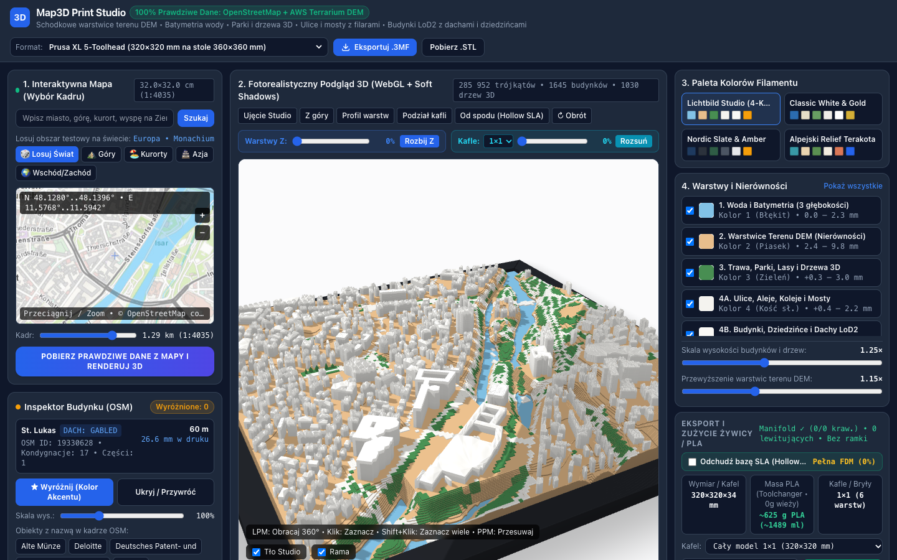
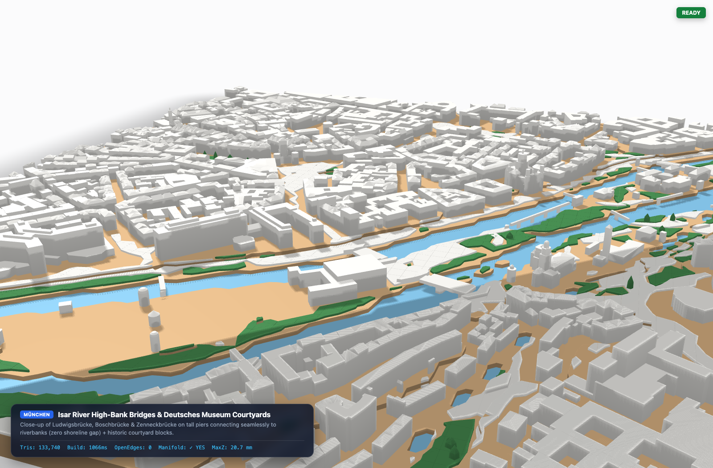

# map-to-3dprint

`map-to-3dprint` generates multi-color, watertight 2-manifold 3D-printable terrain and city models (`.3mf`, `.stl`, and multi-tile `.zip`) from live geographic data.

The system downloads elevation tiles from AWS Terrarium DEM and vector geometry (including `multipolygon` relations) from OpenStreetMap (Overpass API). It builds six disjoint, closed manifold volumes (`0` open edges, `0` non-manifold edges, `0` inter-layer overlap, `0` floating elements) for:
- **Resin SLA / MSLA 3D Printers** (tailored for the **Anycubic Photon Mono 4** with a `153.4 × 87 × 165 mm` build volume, `0.05 mm` layer height, automatic multi-tile splitting, a continuous `1.8 mm` hollow underside vault, and `4` perimeter SLA drain channels per tile).
- **Multi-Extruder FDM 3D Printers** (such as Prusa XL 5-Toolhead, Bambu Lab X1C/P1S AMS, and Voron 2.4 ERCF, with a `0.20 mm` layer height and a flat `z = 0 mm` base for slicer infill).



---

## 1. System Description

The application operates in two modes:

1. **Local GIS Server + WebGL Studio (`server.py`)**: A Python HTTP server fetches, validates (`validate_processed_scene`), and caches metric-square DEM and OpenStreetMap `scene_v4` data on disk.
2. **Standalone Browser Mode (`index.html`)**: The browser fetches AWS Terrarium DEM tiles and Overpass QL data directly when the local Python server is offline.

### Data Sources

| Data Layer | Source | Format | Usage |
| :--- | :--- | :--- | :--- |
| Elevation (DEM) | AWS Terrain Tiles (`terrarium`) | 24-bit PNG (`z = 14`) | Metric-square stepped terrain contour layers and sea-level bathymetry |
| Vector Geometry | OpenStreetMap (Overpass API) | JSON (`way` + `relation`) | Buildings (`building`, `building:part`), inner courtyards (`multipolygon`), coastlines (`natural=coastline`), piers (`man_made=pier`), water, parks, trees, roads, bridges |
| Geocoding | Photon Komoot (`photon.komoot.io`) | GeoJSON | Live place search and coordinate lookup |
| 2D Slippy Map | ArcGIS World Topo / OpenStreetMap France (`hot`) | Raster PNG | Interactive 2D bounding-box (`1:1` aligned with 3D crop) and tile-grid selection |

---

## 2. Disjoint 6-Layer 3D Print Architecture

The mesh builder clips all geometry to the internal model boundary (`[-84.6, 84.6]` scene units), splits geometry across the selected tile grid (`cols × rows`), and stacks layers vertically without volumetric intersection (`ov = {}`). Every exported volume is a closed 2-manifold (`openEdges = 0`, `nonManifoldEdges = 0`, `negativeWinding = 0`).

> [!IMPORTANT]
> The decorative studio frame (`meshes.frame`, Layer `6`) is used only in the 3D WebGL preview. The `.3mf` and `.stl` exporters exclude `meshes.frame` so that only the six printable map layers (`0` through `5`) are exported to the slicer.

| Layer ID | Layer Name | Default Extruder | Disjoint Manifold Structure |
| :--- | :--- | :--- | :--- |
| `0` | Water and Stepped Bathymetry | Extruder 1 (Blue) | Closed water plate (`0.0 – 2.3 mm`) + 3 stepped depth contours |
| `1` | DEM Terrain Contours | Extruder 2 (Sand) | Quantized metric-square elevation terraces from DEM (`2.4 – 9.8 mm`) + continuous underside hollow SLA vault (`1.8 mm`) |
| `2` | Parks, Riparian Banks, and 3D Trees | Extruder 3 (Green) | Closed turf slabs (`evenodd` polygon fill + riparian bank belt) + closed 5-sided 3D tree crowns anchored on the terrace surface |
| `3` | Streets, Plazas, Piers, Bridges | Extruder 4 (Ivory/White) | Closed road prisms anchored on terrain terraces + elevated bridge/pier decks with support columns |
| `4` | LoD2 Buildings and Courtyards | Extruder 4 (White) | Extruded walls, keyhole-preserved inner courtyards (`0` flooded courtyards), terrace-clipped bottom floors (`0` floating buildings), and LoD2 pitched roofs (`hipped`, `gabled`, `pyramidal`, `skillion`, `dome`) |
| `5` | Highlighted Buildings (Accent) | Extruder 5 (Gold/Accent) | User-selected buildings (`Click` / `Shift+Click`) exported as a separate closed volume |
| `6` | Studio Frame *(Preview Only)* | *Not Exported* | Mitered display frame rendered only in the 3D viewport |

### Low-Angle Close-Up — Isar River, Courtyards, and LoD2 Pitched Roofs (Munich)



### Exploded Layer View (Z-Axis Separation — Krakow)


### Top Orthographic View (1:1 Frame Alignment — Krakow)


---

## 3. Anycubic Photon Mono 4 Formats and Hollow SLA Vault

The **Anycubic Photon Mono 4** provides a rectangular build volume of **`153.4 × 87 × 165 mm`**. Because the Y-axis limit is `87 mm`, a single square print cannot exceed `84 × 84 mm`. To print larger square maps (`150 × 150 mm` up to `296 × 296 mm`), `map-to-3dprint` divides the square map into rectangular tiles (`cols × rows`) where every tile fits flat inside `153.4 × 87 mm`:

| Format Preset | Assembled Map Size | Tile Grid (`cols × rows`) | Single Tile Size (`X × Y`) | Hollow Shell `1.8 mm` (`ml` / `g` Total) | Resin per Tile (`ml` / `g`) |
| :--- | :--- | :--- | :--- | :--- | :--- |
| **Photon Mono 4 • Single (`1×1`)** | `84 × 84 mm` | `1 × 1` (1 tile) | `84.0 × 84.0 mm` | **`~16.2 ml` (`~18 g`, `-39%`)** | `~16.2 ml` (`~18 g`) |
| **Photon Mono 4 • Square (`1×2`)** | `150 × 150 mm` | `1 × 2` (2 tiles) | `150.0 × 75.0 mm` | **`~91.8 ml` (`~103 g`, `-39%`)** | `~45.9 ml` (`~51 g`) |
| **Photon Mono 4 • Mosaic (`2×2`)** | `168 × 168 mm` | `2 × 2` (4 tiles) | `84.0 × 84.0 mm` | **`~129.4 ml` (`~145 g`, `-39%`)** | `~32.4 ml` (`~36 g`) |
| **Photon Mono 4 • Large (`2×3`)** | `252 × 252 mm` | `2 × 3` (6 tiles) | `126.0 × 84.0 mm` | **`~447.0 ml` (`~501 g`, `-39%`)** | `~74.5 ml` (`~84 g`) |
| **Photon Mono 4 • XL Wall (`2×4`)** | `296 × 296 mm` | `2 × 4` (8 tiles) | `148.0 × 74.0 mm` | **`~724.0 ml` (`~811 g`, `-39%`)** | `~90.5 ml` (`~101 g`) |

### Multi-Tile 3D Split (`2×3` Tiles of `126 × 84 mm` for Anycubic Photon Mono 4)


### Continuous Underside Hollow Vault (`1.8 mm` Wall + 4 SLA Drain Channels per Tile)

Each tile features a solid perimeter skirt (`WALL_CELLS = 4`, `z = 0 mm`) with `4` perimeter resin drain/vent channels (one at each edge midpoint) and a continuous vertex-interpolated underside vault (`vaultFloorV`) that follows the terrain and water ceiling without enclosed pockets (`cavity = 0`, `negativeWinding = 0`).


---

## 4. Requirements

- **Operating System**: macOS, Linux, or Windows
- **Python**: Version 3.9 or newer (standard library only; no `pip` packages required)
- **Command-Line Tool**: `curl` (installed by default on macOS, Linux, and Windows 10/11)
- **Web Browser**: Chrome, Firefox, Safari, or Edge with WebGL 1.0

---

## 5. Installation, Startup, and Automated Verification

Follow these steps to run the application locally:

1. Clone the repository:
   ```bash
   git clone https://github.com/pisze-programy/map-to-3dprint.git
   ```
2. Change to the project directory:
   ```bash
   cd map-to-3dprint
   ```
3. Start the local GIS server:
   ```bash
   python3 server.py
   ```
4. Open `http://127.0.0.1:8765` in your web browser.
5. *(Optional)* Run the automated geometry, ray-winding, courtyard, and security verification suite:
   ```bash
   python3 tests/run_audit.py
   ```
   This script runs `tests/v3.html` (`160 × 160 = 25,600` vertical rays across 6 scenes × 3 configurations), `tests/roofs.html`, and binary `.STL` ray-winding checks, saving the full report to `tests/audit_report.json`.

---

## 6. Operating Procedure

### 6.1 Select a Geographic Area

1. Type a city, mountain, island, or address into the search box in panel **1. Interaktywna Mapa**.
2. Click a location from the live autocomplete dropdown list, or click **Szukaj**.
3. Alternatively, click one of the world randomizer buttons (`🎲 Losuj Świat`, `⛰️ Góry`, `🏖️ Kurorty`, `🏯 Azja`, `🌍 Wschód/Zachód`) to load a test region.
4. Drag the 2D map with the left mouse button to position the blue print frame. When a multi-tile format is active, dashed cyan lines on the 2D map show the exact tile boundaries (`R1C1` through `R4C2`).
5. Scroll the mouse wheel on the 2D map (or click `+` and `-`) to change the map zoom level.
6. Adjust the **Kadr** slider to set the physical ground width and map scale (`1:1` synchronized with the 3D model).
7. Click **POBIERZ PRAWDZIWE DANE Z MAPY I RENDERUJ 3D** to download the GIS data and generate the 3D mesh.

### 6.2 Inspect and Multi-Select Buildings


1. Left-click and drag in the 3D viewport to rotate the camera.
2. Right-click and drag (or middle-click and drag) in the 3D viewport to pan the camera.
3. Scroll the mouse wheel in the 3D viewport to zoom in or out.
4. Left-click any building in the 3D viewport to select that building group (`building` + all associated `building:part` elements).
5. Hold `Shift` and left-click additional buildings to select multiple buildings at the same time.
6. In the **Inspektor Budynku (OSM)** panel, click **★ Wyróżnij (Kolor Akcentu)** to move the selected buildings to the accent extruder layer (Layer 5).
7. Adjust the **Skala wys.** slider to change the height multiplier (`50%` to `250%`) of the selected buildings.
8. Click **Ukryj / Przywróć** to exclude or restore the selected buildings from the 3D print mesh.

### 6.3 Inspect Layers, Tiles, and Hollow Underside

1. Drag the **Warstwy Z** slider (or click **Rozbij Z**) to separate the six volumes along the Z-axis.
2. Select a tile grid (`1×1`, `1×2`, `2×2`, `2×3`, `2×4`) in the **Kafle** selector and drag the tile slider (or click **Rozsuń**) to separate the printer tiles in 3D space.
3. Click **Od spodu (Hollow SLA)** to inspect the continuous underside hollow vault and `4` perimeter drain channels per tile from below.
4. Toggle **Odchudź bazę SLA (Hollow 1.8 mm)** in the bottom-right panel to compare solid versus hollowed resin consumption in milliliters (`ml`) and grams (`g`) without changing the Z-step quantization.

### 6.4 Export for 3D Printing (`.3MF`, `.STL`, or Multi-Tile `.ZIP`)

1. Select your target printer format in the top bar (**Anycubic Photon Mono 4** `1×1`, `1×2`, `2×2`, `2×3`, `2×4`, or **FDM** `220×220 mm` to `440×440 mm`).
2. Verify the real-time preflight badge (`Manifold ✓ (0/0 kraw.) • 0 lewitujących`).
3. In the bottom-right **Kafel** selector, choose either **Wszystkie kafle** (all tiles) or a single tile (`Kafel R1C1`, etc.).
4. Click **Pobierz .STL**:
   - For multi-tile formats with all tiles selected, the application downloads a `.zip` archive containing individual binary `.stl` files for every tile (pre-positioned at `[0 .. tileWidth] × [0 .. tileHeight] mm` to fit directly on the `153.4 × 87 mm` build plate) plus a printing instruction file (`INSTRUKCJA_DRUKU_PHOTON_MONO_4.txt`).
   - Because layers `0` through `5` are vertically disjoint (`ov = {}`), the combined single-tile `.STL` has `0` self-overlapping rays (`windingGt1 = 0`).
5. Click **Eksportuj .3MF** to download a multi-object `.3mf` archive with welded shared vertices (`toFixed(3)` mm) and per-tile assembly `<object>` items (`Kafel_R1C1`, etc.) for PrusaSlicer, Bambu Studio, or OrcaSlicer.

---

## 7. Verification Examples

### Alpine Relief (Innsbruck, Austria — `149,634` Triangles • `1,711` Buildings • `1,594` 3D Trees)


### Dense Urban Grid and River Bridges (Tokyo, Japan — `381,342` Triangles • `6,858` Buildings • `462` 3D Trees)


### Coastal Sea Bathymetry and 3D Pier (Sopot, Poland — `262,608` Triangles • Baltic Sea `natural=coastline` + `Molo w Sopocie`)


---

## 8. Modular Architecture and Build

If you modify `src/template.html` or the initial scene dataset, run `build_app.py`:

```bash
python3 build_app.py
```

### Repository Structure (Modular Per-Feature Layout)

| Path | Description |
| :--- | :--- |
| `server.py` | Local HTTP server (`/api/gis`, `/api/geocode`, static file serving with hidden-file protection on `GET` and `HEAD`) |
| `fetch_gis.py` | Downloader for AWS Terrarium DEM PNG tiles and Overpass QL vectors (with payload validation) |
| `gis_geometry.py` | 2D polygon ring stitching, coastline sea polygon closure, and processed-scene validation (`validate_processed_scene`) |
| `gis_pipeline.py` | Metric-square DEM sampling, OSM feature extraction, and `scene_v4` caching |
| `build_app.py` | Generates `src/initial_scene.js` and modular `index.html` (`465` lines) from `src/template.html` |
| `src/template.html` | HTML5 layout and responsive CSS variables |
| `src/geometry_2d.js` | 2D polygon geometry, keyhole courtyard merging (`mergeHolesIntoOuterKeyhole`), convex/box clipping (`clipPolyByConvex`), and ear-clipping triangulation |
| `src/mesh_extrude.js` | 3D mesh primitive emitters, watertight 2-manifold LoD2 building extrusion (`extrudeBuildingLoD2`), and 3D tree crowns |
| `src/mesh_topology.js` | Exact mathematical volume (`ml`), resin/PLA mass (`g`), and welded (`toFixed(3)` mm) manifold preflight (`computePrintMetricsAndTopology`) |
| `src/mesh_builder.js` | Core 3D map & SLA hollow vault builder (`buildComplete3DModel`: DEM terraces, bathymetry, disjoint feature slabs, bridges, buildings) |
| `src/webgl_shaders_math.js` | GLSL shadow/studio shaders, 4×4 matrix math, and Möller–Trumbore ray-triangle intersection |
| `src/webgl_studio.js` | WebGL 1.0 studio renderer (`createWebGLStudio`) with 2048×2048 PCF shadow mapping, 3D tile explode, and building picking |
| `src/video/video_studio_view.html` | HTML layout partial for the Video Preview & Framed Order Demo Studio (`#videoStudioRoot` & `#vidOrderDemoModal`) |
| `src/video/video_config.js` | Video presets (including Dubai Burj Khalifa), 5 storyboards, aspect ratios, and frame/passe-partout/studio catalogs |
| `src/video/video_math_mesh.js` | Easing curves (`applyVideoEasing`) and coplanar-diagonal-suppressing barycentric mesh packer (`packMeshForVideoGL`) |
| `src/video/video_shaders.js` | Vertex deformation & 2048×2048 shadow map GLSL shaders (`VIDEO_SHADOW_VS`, `VIDEO_MAIN_VS`) |
| `src/video/video_shader_main_fs.js` | Cinema fragment shader (`buildVideoMainFS`: PCF shadows, cyclorama floor, swept acrylic glass, plaque UV, CAD↔Studio blend) |
| `src/video/video_frame_builder.js` | Parametric 45° mitered 4-rail frame, backing, passe-partout, engraved plaque texture & glass (`buildVideoProductFrameBuffers`) |
| `src/video/video_timeline_2d.js` | Deterministic timeline choreographer (`evaluateVideoTimeline`) & 2D UTM telemetry, whip-pan motion blur, and packshot HUD |
| `src/video/video_recorder.js` | High-bitrate (`16 Mbps`) browser `.mp4`/`.webm` `MediaRecorder` exporter (`recordCanvasVideoBlob`) |
| `src/video/video_gl_engine.js` | Multi-slot GPU manager & 2-pass WebGL renderer (`createVideoPreviewEngine`) |
| `src/video/ui_video_map_gis.js` | 2D fragment selector, Photon place search, cached preset loader, and live GIS fetcher (`createVideoMapGisController`) |
| `src/video/ui_video_order_demo.js` | Solo/Duet/Triptych set composer, EUR/PLN pricing, Order Demo modal & `.JSON` spec export (`createVideoOrderDemoController`) |
| `src/video/ui_video_controls.js` | Element & landmark chips, storyboard/frame/shader DOM bindings, state sync & `.WEBM`/`.MP4`/`.PNG` export triggers (`createVideoControlsController`) |
| `src/video/ui_video_studio.js` | Main coordinator, playback RAF loop, interactive orbit & 3D configurator sync (`initVideoStudioModule`) |
| `video_studio.html` | Standalone entry point for the Browser Video Preview & Order Demo Studio module |
| `src/export_stl_zip.js` | CRC32, ZIP archive builder, binary `.STL` exporter, and multi-tile Anycubic Photon Mono 4 `.ZIP` packager |
| `src/export_3mf.js` | Multi-volume `.3MF` exporter with vertex welding and per-tile `<object>` assemblies |
| `src/ui_config.js` | Palettes, layer metadata, global world locations, and printer profiles |
| `src/ui_map2d.js` | Web Mercator tile projection and interactive 2D slippy map canvas renderer (`createMap2DController`) |
| `src/ui_gis_client.js` | Direct in-browser GIS pipeline (`fetchTerrariumDemInBrowser`, `fetchRealGISInBrowser`) |
| `src/ui_panels.js` | Palettes, layers, multi-select building inspector, landmark chips, and print stats UI (`createUIPanelsController`) |
| `src/ui_app.js` | Main application controller (`initMap3DApp`), 3D/2D viewport events, Photon Komoot autocomplete, and URL hooks |
| `tests/` | Automated verification suite (`tests/v3.html`, `tests/roofs.html`, `tests/run_audit.py`, `tests/audit_report.json`) |
| `docs/screenshots/` | Verification screenshots across camera angles, printer tile grids, and geographic regions |
