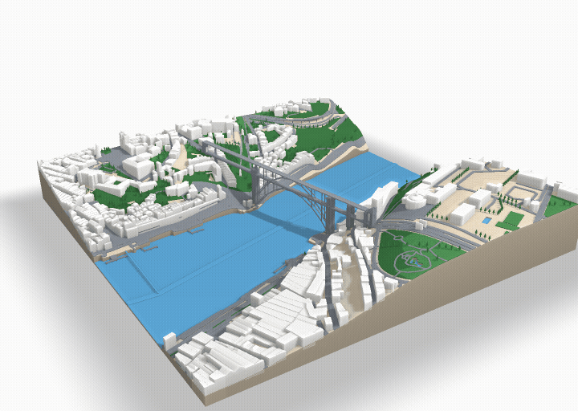
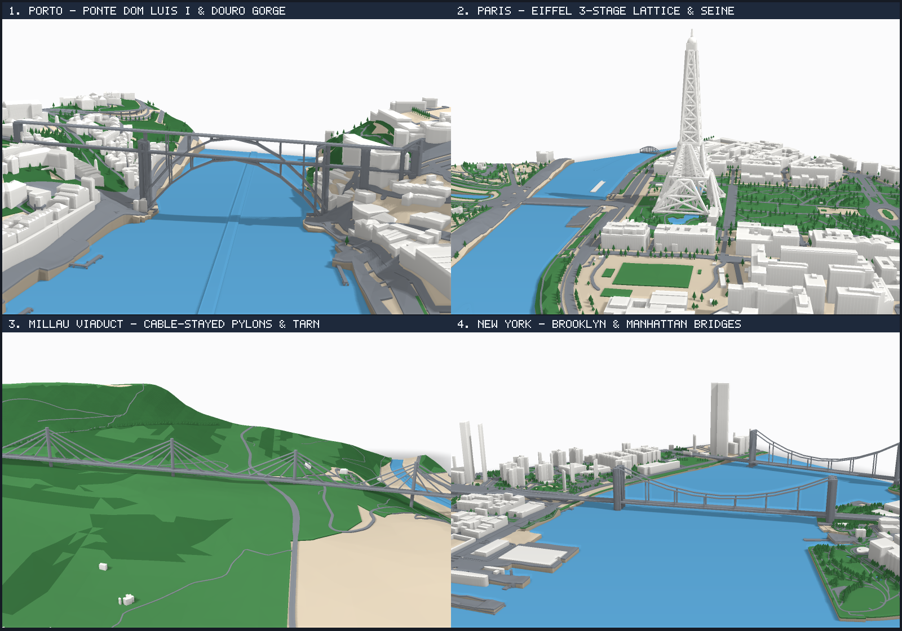
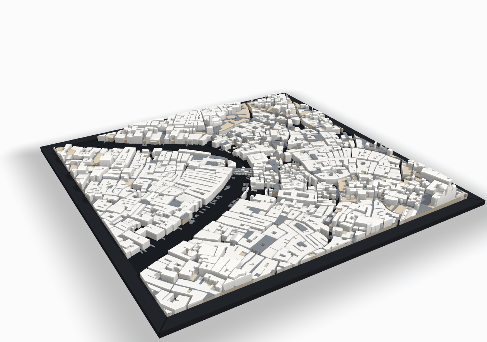
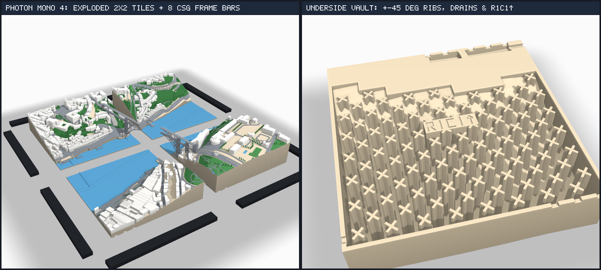
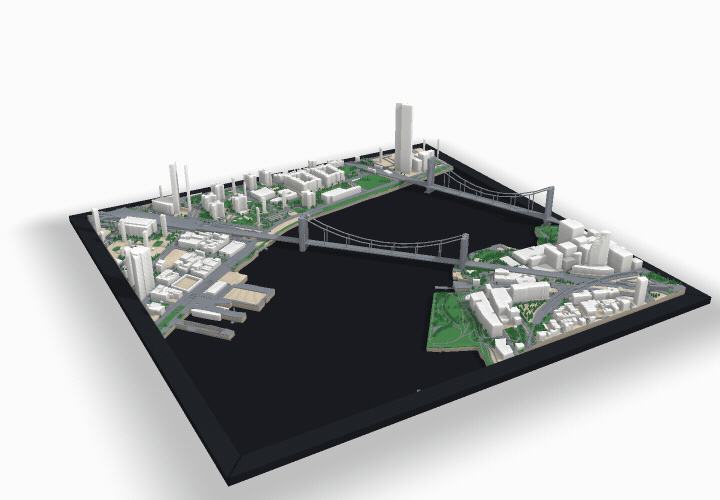

# map-to-3dprint

`map-to-3dprint` turns live OpenStreetMap vectors (`S3DB` buildings, bridges, piers, lattice landmarks) and AWS Terrarium DEM elevation into watertight, zero-defect 2-manifold `.STL`, multi-tile `.ZIP`, and multicolor `.3MF` architectural dioramas with 98% OSM Wiki fidelity. Engineered exclusively for the **Anycubic Photon Mono 4** (`153.45 × 87.05 × 165.0 mm`, `17 µm` XY / `50 µm` Z MSLA resin), every tile enforces cure-safe wall/strut/pin physics, `±45°` anti-suction cross-ribs, dry drainage, and Manifold CSG segmentation.



---

## Visual Showcase

### Architectural S3DB, Bridges & Parametric Lattice (Porto, Paris, Millau, New York)


### `waterCutout` Exposed Matte-Black Backing in Manifold CSG Wall-Art Frame (Venice)


### Photon Mono 4 `2×2` Exploded Tiles + 8 CSG Frame Bars & Hollow Vault (`±45°` Ribs, Drains, `R1C1^`)


### Studio Packshot — Disjoint Layer Separation Over `waterCutout` Backing


---

## Geometry & Photon Mono 4 Print Architecture

| Subsystem | Key Engineering & MSLA Invariants |
| :--- | :--- |
| **S3DB 17 Roofs & Spires** | Full OSM Simple 3D Buildings parser supporting 17 roof shapes (`flat`, `gabled`, `hipped`, `half-hipped`, `pyramidal`, `dome`, `onion`, `round`, `skillion`, `mansard`, `gambrel`, `saltbox`, `butterfly`, `sawtooth`, `cone`, `quadruple_saltbox`/`side_hipped`, `stepped`), `StraightSkeleton` courtyards, shared `min(DEM)` group datum, and `tanh` spire cap (`capSpireProtrusionMm`) keeping tall needles within Mono 4 Z budgets. |
| **Global OSM Bridge Graph & MSLA Reinforcement** | Continuous road/rail bridge stitching (`bridge_axis_helper.js`, `bridge_graph_solver.js`), parametric arch/cable-stayed/suspension/truss superstructures, MSLA `17 µm` wall/strut/pin rules (`minWallThicknessMm >= 0.45 mm`, `minStrutDiameterMm >= 0.48 mm`, `minPinDiameterMm >= 0.65 mm`), and anti-capillary resin-trap clearance (`resolveAntiCapillaryGapMm >= 0.48 mm`). |
| **Delatin TIN, Waterfronts & Supportless Toggle** | Adaptive `Delatin` TIN terrain relief with monotonic mountain river carving, waterfront quay/pier walls, parametric lattice/wheel/turbine archetypes, and optional `>= 40°` self-supporting corbel/arch toggle (`#chkSupportlessMode`, off by default for 98% true-shape accuracy). |
| **Hollow SLA Vault & CSG Export** | `>= 2.0 mm` hollow vault with `±45°` anti-suction cross-ribs (`10.5 mm` pitch), `>= 2` perimeter dry drain channels (`3.6 × 1.55 mm`) per chamber (automatic solid fallback for water-locked islands), unmirrored `R1C1^` underside emboss (`>= 0.72 mm` stroke, `0.68–0.82 mm` depth), per-tile Manifold CSG `.STL` + 4-strip frame splitter, and multicolor `.3MF` (`0` open / `0` non-manifold edges). |

---

## Quick Start & Offline Verification

```bash
npm install
python3 build_app.py        # Rebuilds modular index.html (74 JS modules)
npm run test:headless       # Runs all 9 pure-Node geometry, S3DB, bridge, vault & export suites
npm run verify:15scenes     # Audits 15 cached world scenes (0 open / 0 non-manifold / 0 floating)
npm run inspect:3d          # Runs offline 3D scene & headless renderer inspector
```

> **Optional Supportless Print Mode:** Enable **Tryb bez podpór (`#chkSupportlessMode`)** in the UI (or pass `?supportless=1` / `supportlessMode: true`) to substitute `>= 40°` self-supporting corbels and arches for suspended horizontal overhangs.

## Core Modules

| Area | Modules |
| :--- | :--- |
| **Physics & Manifold Core** | `src/geometry/sla_print_laws.js`, `print_physics_config.js`, `polygon_2d.js`, `obb_medial_2d.js`, `manifold_core.js` |
| **3-Layer Mesh Pipeline** | `src/mesh/layer1_*`, `layer2_archetypes.js`, `layer3_invariants_tiles.js`, `s3db_*`, `bridge_*`, `terrain_*`, `tile_sla_vault_solver.js`, `tile_id_emboss.js`, `frame_csg_solver.js` |
| **Exporters & Headless QA** | `src/export/stl_writer.js`, `zip_packager.js`, `export_3mf.js`, `tools/headless_scene_harness.js`, `tools/headless_3d_renderer.js`, `tools/mcp_map3d_inspector.mjs` |
